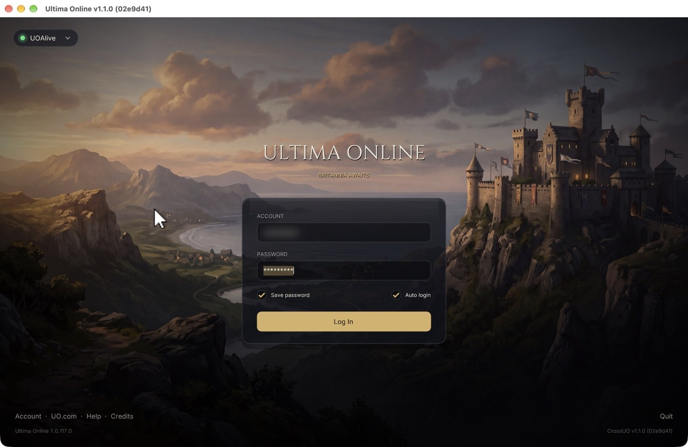

<!--
SPDX-FileCopyrightText: 2020 Danny Angelo Carminati Grein
SPDX-FileCopyrightText: 2026 Christopher Brand
SPDX-License-Identifier: AGPL-3.0-or-later
-->
# EmmexUO

An Ultima Online client built for the Mac: native on Apple Silicon, fast, and with an
interface that feels like it belongs in this decade, without losing what made the classic
game worth playing.

The name is a nod to the chips it's built for: **M** ("Emm") for Apple Silicon, then a
number, or an **ex**: M1, M2, M*x*. EmmexUO.



## Why this exists

Ultima Online is still alive, and still a wonderful game, but playing it on a modern Mac
means Rosetta, Wine, or a client designed for 640×480 CRTs. This project starts from the
open-source [CrossUO](https://github.com/crossuo/crossuo) client and takes it somewhere
specific.

## What we believe

- **Mac-first, not Mac-also.** Native arm64, Metal rendering, Retina-sharp text, real
  full screen, and the shortcuts you expect (⌘, for settings, ⌘= / ⌘- to scale the UI).
- **Modern interface, classic game.** We redesign screens and panels so they're clear and
  pleasant to use, but the game itself (its rules, its world, its feel) stays the game.
- **Better art, never broken art.** Higher-resolution replacement graphics are
  layered on top of the original assets, and anything without a replacement falls back to
  the original, so nothing ever goes missing.
- **Plays with the servers people actually use.** Standard UO data files and protocol;
  no server changes required.
- **Fast and light.** 60 fps by default, quick startup, and no hidden background work.
- **Open source, with credit where it's due.** Built on CrossUO and the work of its
  contributors, and released under the same licences.

## Status

Early and moving quickly. Working today:

- Native Apple Silicon build and a signed `.app` bundle
- Metal renderer (default) with the GL3 renderer as a fallback
- Current EA client data (BWT-compressed gumps and clilocs) and Retina displays
- Fractional UI scaling, resizable game window, and full screen
- Modern overlays: journal, settings, macro editor, target vitals
- A redesigned, resizable login screen
- Servers managed right on the login screen: live online/offline status, switch with a
  click, edit any server in place, add new ones (no separate launcher step)

Next up: the shard, character and character-creation screens, then HD art replacement.

## Building (Apple Silicon)

Requires Xcode command line tools, CMake and Ninja (`brew install cmake ninja`).

```sh
cmake -B build -S . -G Ninja -DCMAKE_OSX_ARCHITECTURES=arm64 -DCMAKE_BUILD_TYPE=Release
cmake --build build
tools/macos/make_app.sh            # optional: assembles build/dist/EmmexUO.app
```

Run `build/src/crossuo` (or open `EmmexUO.app`). Servers are added and edited from the
login screen; on a first run without game data the bundled launcher opens to set it up.
You need your own copy of the Ultima Online client data files.

Other platforms still build as they did in CrossUO; see
[Compiling](docs/CONTRIBUTING/Compiling.md).

## Contributing

Issues and pull requests are welcome. Please read [CONTRIBUTING](docs/CONTRIBUTING.md)
first.

## Credits and licence

EmmexUO is a fork of [CrossUO](https://github.com/crossuo/crossuo) by Danny
Angelo Carminati Grein and contributors, itself derived from OrionUO by Hotride. Code is
licensed under AGPL-3.0-or-later and MIT as marked in each file (see `LICENSES/`).
Bundled fonts (Cinzel, Inter) are under the SIL Open Font License 1.1.

Ultima Online is a trademark of Electronic Arts / Broadsword. This project is not
affiliated with or endorsed by them.
